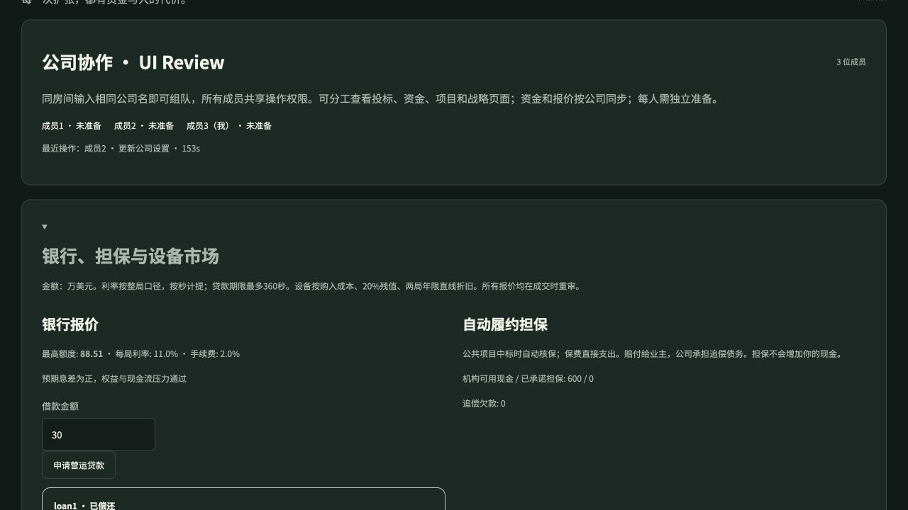

# 财务经营游戏 · Financial Management Game

A multiplayer construction-business simulation: bid for contracts, manage cash, buy and trade equipment, borrow from a risk-pricing bank, and earn surety capacity through sound finances.

**试玩 / Play:** https://financial-management-game.enzel541168.chatgpt.site



## How to play

1. One person creates a 15, 18 or 20 minute room and shares its room code. Invite 2–12 companies; bots can fill empty seats.
2. Teammates enter the same company name to share one business. Each company has 1–4 members sharing $1.6 million and 8 free ability points; resources do not increase with headcount. Each person completes the guide and confirms readiness. Roles divide strategy, bidding, finance and operations; smaller teams combine roles. The general manager can reassign roles.
3. Allocate capabilities, plan a budget and bid. Contracts consume crews and cash before all customer payments arrive.
4. Open **Bank, surety & equipment market** to obtain working capital or equipment financing, buy new/used assets, list your equipment, and track bonds and loans.
5. Compare operating performance with company health. The finance center explains statements, ratios, budgets and cash movements.

Chinese, English, Spanish, French and Hindi are supported. Amounts use USD 10,000 units. Run your company through a competitive business cycle. All contracts and companies use simulated data.

### Three connected institutions

- **Surety:** automatic risk review on public-work awards, finite bond capacity, paid premiums, owner compensation and contractor recourse. A bond never supplies company cash.
- **Equipment:** new and used dealer stock, player-to-player sales, ownership, liens, productive use, depreciation, maintenance and disposal gains/losses.
- **Bank:** finite capital, risk-based loan offers, fees, accrued interest, repayment, maturity, delinquency and collateral liquidation. A default affects future credit.

See [the exact financial rules and limitations](docs/financial-model.md) and [validation evidence](docs/validation.md).

## Run locally

Requirements: Node.js ≥22.13 and pnpm 10.11.0. The app uses React/Vinext and Cloudflare D1. It is **not a GitHub Pages static app**.

```sh
corepack enable
pnpm install --frozen-lockfile
pnpm exec wrangler d1 execute DB --local --config wrangler.local.jsonc --persist-to .wrangler/state --file drizzle/0000_parallel_alex_power.sql
pnpm dev
```

Open the printed local URL (normally `http://127.0.0.1:5173`). Local D1 state is stored under ignored `.wrangler/`. The initialization command is needed only for a fresh local database. Never commit `.wrangler`, credentials or real room exports.

```sh
node --test tests/*.mjs
node node_modules/typescript/bin/tsc --noEmit --incremental false
# With the local development server running:
node tests/integration/local-api.mjs
pnpm build
```

The HTTP test is loopback-only and creates a dedicated local test room. Legacy-rule fixtures test saved-game compatibility; separate institution tests exercise new public rooms at every simulated second.

## Hosting

The supplied Vite/Sites integration builds a Cloudflare Worker with a D1 `DB` binding. `.openai/hosting.json` describes bindings. For a new Sites deployment, register your own site and set its project ID through the Sites workflow; this repository does not contain the original site's publishing credential or private source history.

For a self-managed Cloudflare deployment, create a D1 database, apply `drizzle/0000_parallel_alex_power.sql`, build the Worker, and configure the generated `dist/server/wrangler.json` with your Worker name and D1 database ID before `wrangler deploy`. The database must be bound as `DB`. No account secret belongs in source control. Deployment requires your own Cloudflare/Sites account and is separate from publishing this repository.

## Scope and safety

Room credentials are random bearer tokens, hashed at rest. Room state expires after seven days. Company names and scores are visible to room participants; use fictional names. A matching company name permits teammates to join, so room codes should be shared only with intended participants. The game is designed for friendly sessions, not adversarial real-money competition.

The public source contains the full simulation only. Room data, private coursework, local backups, hidden edition code and original Git history are excluded. A clean public release history is used.

Third-party notices are in [THIRD_PARTY_NOTICES.md](THIRD_PARTY_NOTICES.md). Dependency versions are locked. No external photographs, paid assets or course attachments are required.

## Source rights

Publication makes this source viewable; no additional reuse license for original game code is granted by this repository. Third-party code remains governed by its retained licenses.

## Team permissions and opening balance

One company starts with **USD 1.6 million (160 game units) and 8 free ability points**, regardless of its 1–4 members. Company-design foundation levels are separate; adding players adds no resources. These are game-balance settings, not a real contractor capitalization recommendation.

General manager: company design, points, upgrades, strategy and role assignments. Project manager: bids, joint bids and market information. Finance manager: budgets, reserves, borrowing and repayment. Operations manager: equipment, construction routines and workforce. All members can read company data. Solo players hold every role; two split general/project and finance/operations; three combine general/operations; four hold one role each. Existing oversized rooms retain their seats, but only the first four have operating roles; new joins are capped at four.

In multiplayer companies, bids (company contract share), loans and equipment purchases at the threshold (default 50 game units), plus any financed equipment purchase, require **another** general or finance manager to approve. Requests reserve no cash and submit no bids; they expire after 120 game seconds. Live conditions are rechecked on approval. Role/threshold changes clear pending requests. Single-player companies act directly. General managers can set the threshold from 10 to 1,000,000. Approved automatic strategic tasks execute as company plans. The shared log retains the last 150 successful actions/requests in the current round.

## Public room lobby

The home page lists public, not-yet-started rooms with free company seats and a host active in the last 10 minutes. It refreshes every 5 seconds. Select an existing company (maximum 4 members), or create a new company (maximum 12 per room). New rooms default to public and can be set to unlisted before creation or by the host before starting. Old rooms are not automatically listed. Only room code, duration, company names and headcounts are exposed, never player credentials, nicknames, bids or financial data. Starting a round removes its room from the lobby.
